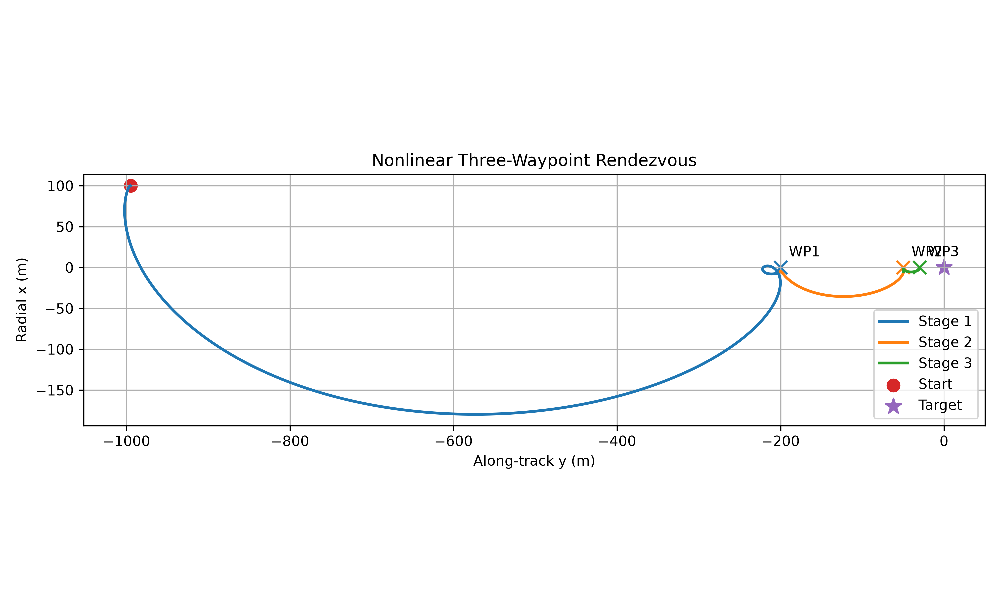
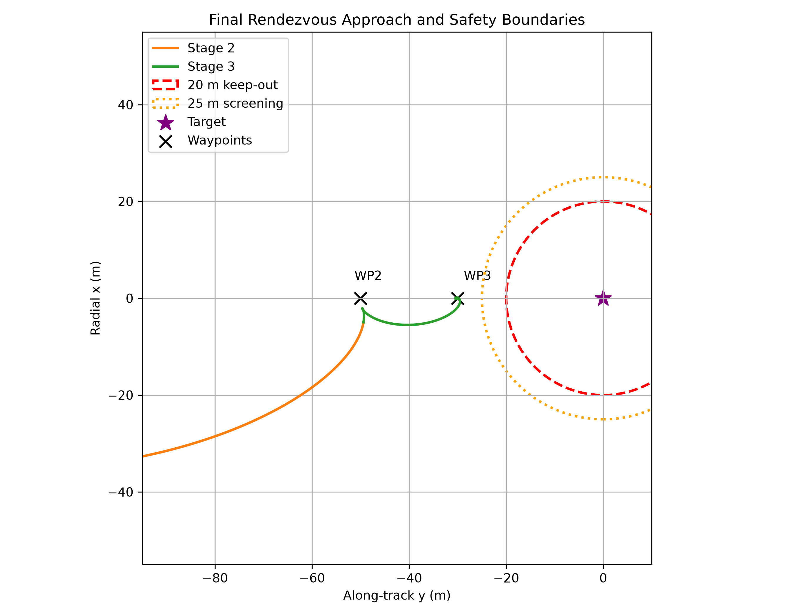
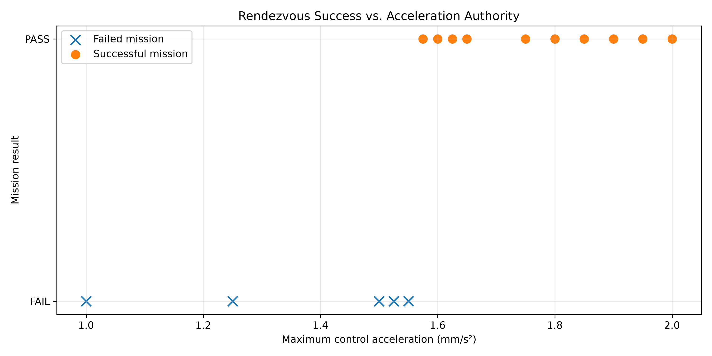
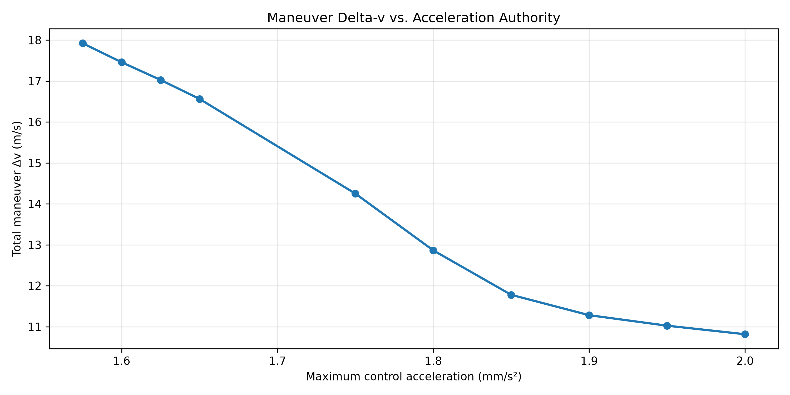
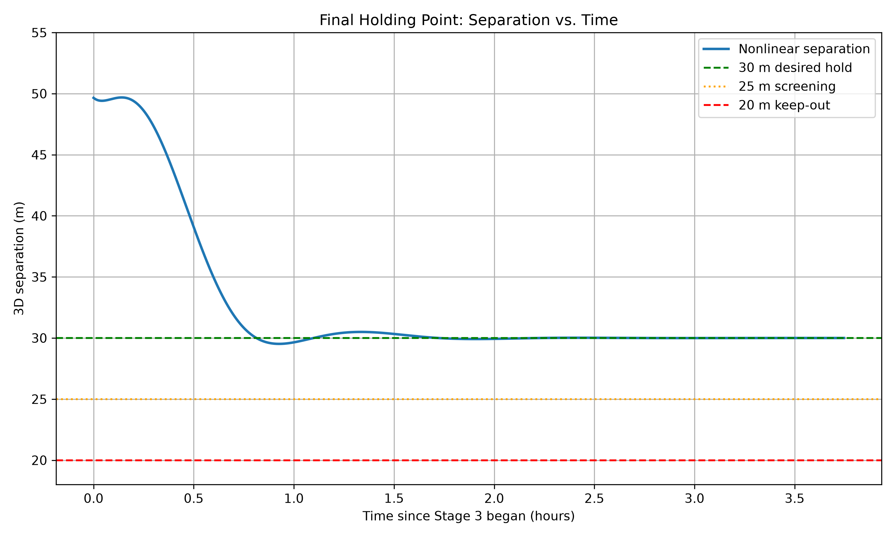

# Autonomous Satellite Rendezvous Using LQR Control

A Python-based spacecraft guidance, navigation, and control simulation demonstrating autonomous multi-waypoint rendezvous in low Earth orbit.

Developed and validated an autonomous satellite rendezvous simulation using HCW dynamics, nonlinear two-body propagation, and LQR control, with Monte Carlo simulations and sensitivity studies to evaluate mission performance under varying initial conditions.

## Project Overview

The simulated chaser spacecraft autonomously approaches a target from approximately 1 km away, transitioning through three relative-position waypoints:

- **Waypoint 1:** 200 m
- **Waypoint 2:** 50 m
- **Waypoint 3:** 30 m final holding position

Waypoint transitions are governed by position and velocity acceptance tolerances. Control accelerations are limited to represent finite actuator authority, and a 25 m screening boundary is monitored during propagation.

### Nonlinear Rendezvous Trajectory

*Figure 1. Simulated chaser trajectory in the LVLH reference frame during the autonomous three-waypoint rendezvous.*

### Final Approach and Safety Boundaries

*Figure 2. Close-range approach trajectory relative to the 25 m screening boundary and 20 m keep-out boundary.*

## Technical Implementation

**Orbital Dynamics**

- Implemented HCW relative-motion equations in the Local Vertical Local Horizontal (LVLH) reference frame.
- Implemented nonlinear two-body orbital propagation in Earth-Centered Inertial (ECI) coordinates.
- Developed ECI–LVLH position and velocity transformations.
- Compared analytical HCW solutions, numerical HCW propagation, and nonlinear orbital dynamics.

**Guidance and Control**

For the controller formulation, weighting matrices, and implementation assumptions, see the [LQR Controller Design](docs/lqr_controller_design.md) documentation.
- Designed a continuous-time LQR controller using state-space dynamics and the algebraic Riccati equation.
- Implemented autonomous waypoint transitions using position and velocity tolerances.
- Enforced a maximum control acceleration of 0.001 m/s² for the baseline mission.
- Integrated applied acceleration magnitude to estimate cumulative maneuver Δv.

**Validation and Sensitivity Analysis**

- Verified numerical convergence using solver step-size and tolerance refinements.
- Developed automated unit and regression tests.
- Evaluated initial position and velocity perturbations through reproducible Monte Carlo experiments.
- Conducted an acceleration-authority sensitivity study for a challenging initial condition.

## Nominal Mission Results

| Performance metric | Simulated result |
|---|---|
| Final holding distance | 30 m |
| Minimum separation | 29.520 m |
| Total maneuver Δv | 1.026717 m/s |
| Final position error | 0.000533 m |
| Final velocity error | 0.000001119 m/s |
| Maximum available acceleration | 0.001 m/s² |
| Final waypoint acceptance | PASS |

These results represent idealized numerical simulations, not flight-demonstrated performance.

## Monte Carlo and Sensitivity Analysis

A 52-scenario initial-condition study produced 51 successful missions and one failure under the baseline acceleration limit.

The failed scenario, `extreme50_03`, did not satisfy the first waypoint acceptance conditions within the simulation duration.

A subsequent control-authority sensitivity study identified:

- **0.001550 m/s²:** Mission failed.
- **0.001575 m/s²:** Mission succeeded.

This represents an empirical failure-to-success interval for the tested initial condition and the implemented controller, not a universal minimum acceleration requirement.

The observed 98.1% success rate is specific to the selected test scenarios and should not be interpreted as real-world mission reliability.

## Simulation Figures

## Sensitivity Analysis Figures

The acceleration-authority study evaluates the response of a challenging initial condition to different maximum control accelerations.

### Mission Success vs. Control Authority

*Figure 3. Mission success or failure as the available control acceleration changes.*

### Maneuver Delta-v vs. Control Authority

*Figure 4. Cumulative maneuver delta-v for successful runs at different acceleration limits.*

### Final Holding Performance

*Figure 5. Relative separation during the final 30 m holding phase of the nominal mission.*

## Installation and Execution

Requires Python and the dependencies listed in `requirements.txt`.

Install dependencies:

`python -m pip install -r requirements.txt`

Run the nonlinear rendezvous simulation:

`python -m scripts.run_nonlinear_three_waypoints`

Run the Monte Carlo robustness study:

`python -m scripts.run_robustness_sweep`

Run the acceleration-authority sensitivity study:

`python -m scripts.run_acceleration_study`

Generate acceleration study figures:

`python -m scripts.plot_acceleration_sweep`

Run automated tests:

`python -m pytest -q -p no:cacheprovider`

## Model Assumptions and Limitations

- Circular target reference orbit.
- Ideal nonlinear two-body gravitational dynamics.
- Continuous, perfectly directed thrust acceleration.
- Exact simulated relative-state feedback without navigation measurement noise.
- No J2 perturbations, atmospheric drag, or third-body gravitational effects.
- Nominal separation-boundary monitoring rather than probabilistic collision-avoidance guarantees.

The simulation demonstrates a preliminary GN&C architecture and its modeled performance under specified conditions. Future extensions could include navigation uncertainty, orbital perturbations, discrete thruster actuation, and more comprehensive safety analysis.

## Technologies

Python, NumPy, SciPy, Matplotlib, pytest.

Project focus: Orbital mechanics, autonomous spacecraft guidance and control, nonlinear dynamics, numerical verification, and sensitivity analysis.
