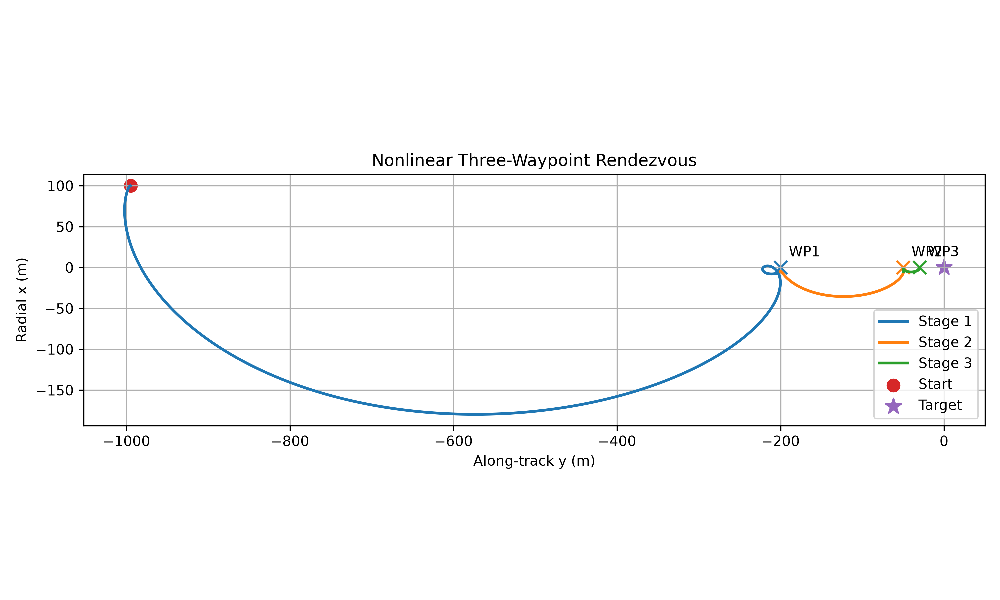
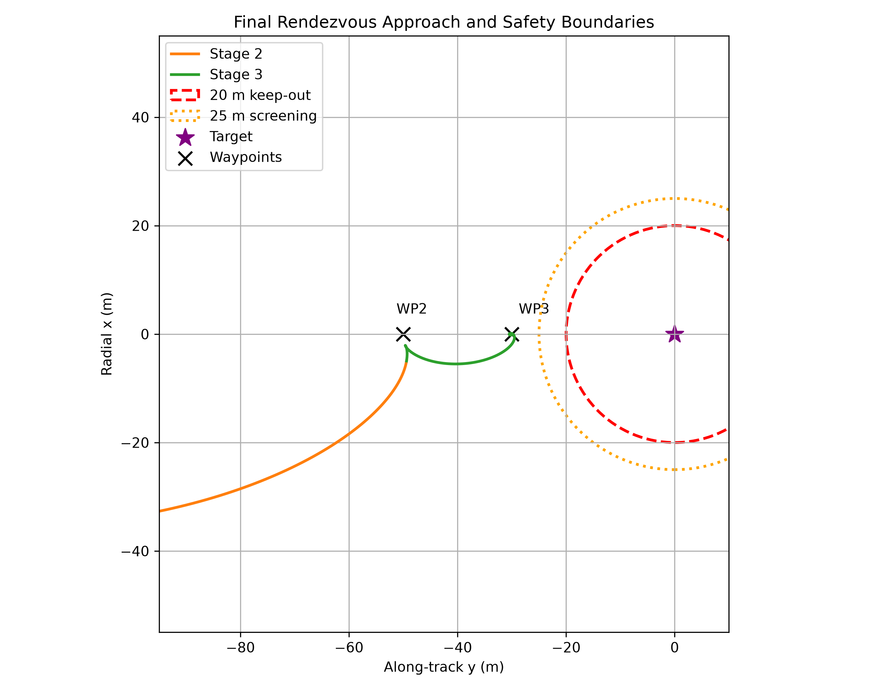
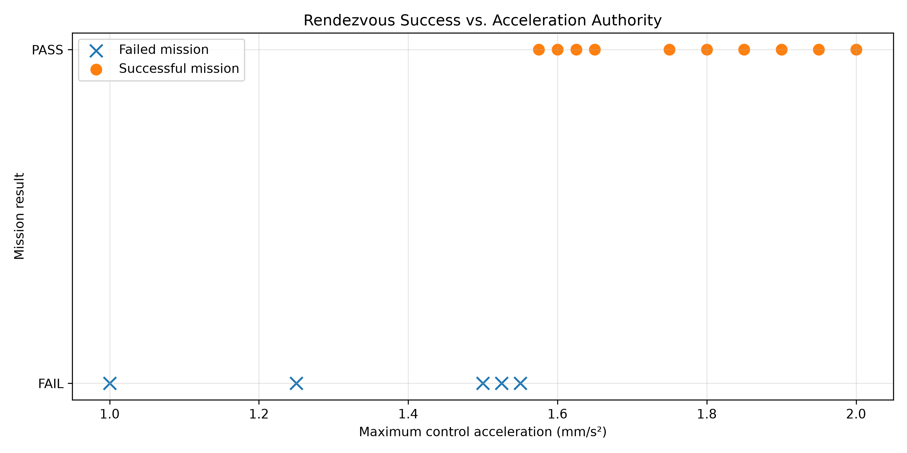
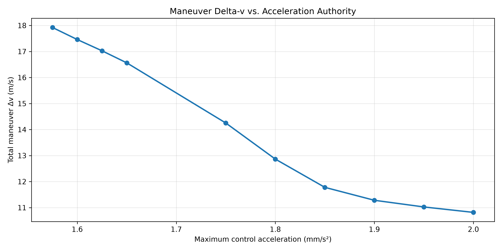
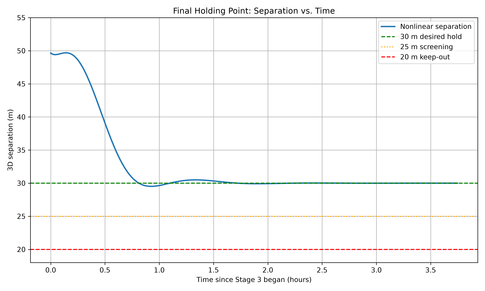
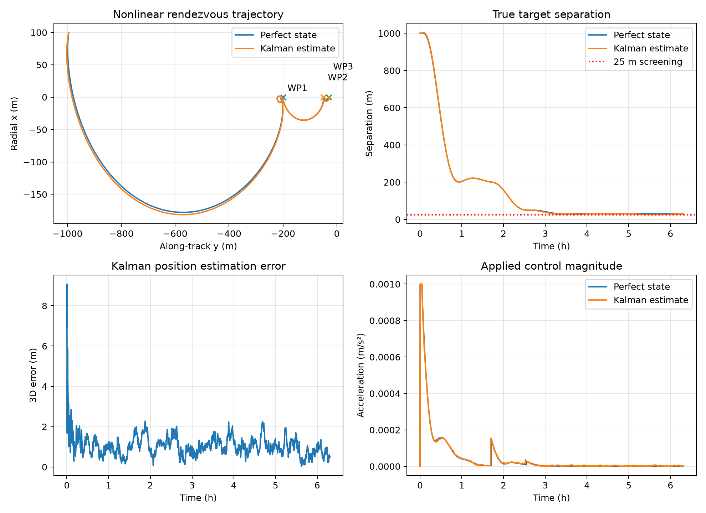
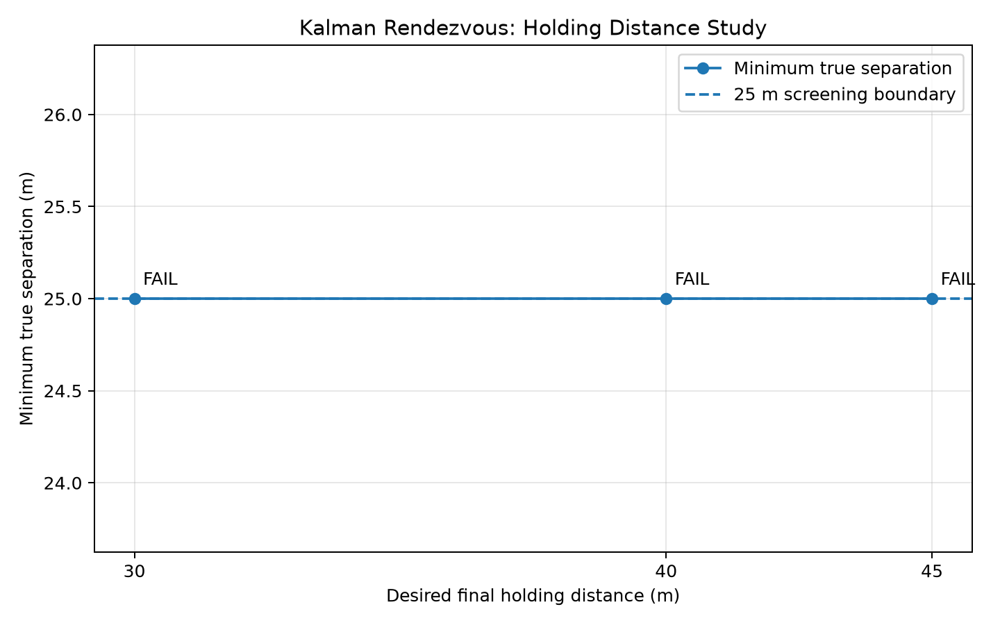

# Autonomous Satellite Rendezvous with LQR and Kalman Filtering

A Python simulation I developed to explore autonomous spacecraft rendezvous using orbital mechanics, feedback control, and state estimation.

I started by using the Hill–Clohessy–Wiltshire (HCW) equations to design an LQR controller, then tested its performance using a separate nonlinear two-body orbital simulation. I later added a Kalman filter to estimate the spacecraft's relative position and velocity from noisy position measurements.

I also evaluated how the system responds to different initial conditions, available control accelerations, and measurement noise.

## Mission Overview

The goal is to guide a chaser spacecraft from approximately 1 km away to a final holding position behind a target satellite in low Earth orbit.

The original mission uses three along-track waypoints:

| Stage | Desired position |
|---|---|
| 1 | 200 m behind the target |
| 2 | 50 m behind the target |
| 3 | 30 m behind the target (final hold) |

The controller adjusts the chaser's acceleration to reduce its position and velocity errors relative to the current waypoint.

The simulation uses:

- A 500 km circular reference orbit.
- A baseline maximum acceleration of 0.001 m/s².
- A 5 m position tolerance and 0.10 m/s velocity tolerance for waypoint acceptance.
- A 25 m screening boundary monitored during the simulated approach.

### Simulated Rendezvous Trajectory



*Figure 1. Simulated three-waypoint approach shown in the target-centered LVLH frame.*

### Final Approach and Safety Boundaries



*Figure 2. Close-up of the final approach, including the 25 m screening boundary and 20 m keep-out reference.*

These figures show a simulated approach with a small initial velocity perturbation.

## How the Simulation Works

The project combines a linear controller, nonlinear orbital dynamics, and a separate state-estimation model.

**1. Relative orbital motion**

I implemented the HCW equations to model how a spacecraft moves relative to another spacecraft in a circular reference orbit.

The equations are useful for controller design because they describe relative position and velocity in a target-centered LVLH coordinate system.

**2. LQR feedback control**

I used the HCW state-space model to implement a Linear Quadratic Regulator (LQR).

The controller compares the current relative state with the desired waypoint and calculates the acceleration needed to reduce the error.

The LQR gain is calculated using SciPy's algebraic Riccati equation solver.

**3. Nonlinear orbital simulation**

To test the controller beyond the linear HCW model, I implemented nonlinear two-body gravitational propagation for both spacecraft in Earth-Centered Inertial (ECI) coordinates.

During propagation, the simulation converts the spacecraft states into LVLH, calculates the control acceleration, applies the acceleration limit, and converts the command back to ECI.

**4. Autonomous waypoint transitions**

The chaser moves through the 200 m, 50 m, and 30 m waypoints. The first two transitions occur when both the position and velocity errors are within their allowed tolerances.

At the final waypoint, the simulation continues through the remaining mission time to evaluate holding performance.

**5. Performance evaluation**

The simulation records separation distance, final position and velocity errors, and estimated maneuver delta-v.

I estimate maneuver delta-v by numerically integrating the magnitude of the applied control acceleration over time.

**6. Kalman state estimation**

I added a discrete Kalman filter that uses the HCW equations to predict the chaser's relative motion and simulated noisy position measurements to correct its estimate.

The filter estimates all six relative-state variables: three positions and three velocities. It does this without directly measuring velocity.

In the extended simulation, the filter and LQR controller update every 10 seconds. The controller uses the estimated relative state rather than the exact simulated state to calculate its acceleration commands.

The spacecraft motion is still propagated using nonlinear two-body dynamics.

For more detail, see the [HCW State-Space Model](docs/hcw_state_space.md) and [LQR Controller Design](docs/lqr_controller_design.md).

## Simulation Results

The unperturbed, perfect-state baseline mission produced the following results:

| Metric | Result |
|---|---|
| Final holding distance | 30 m |
| Minimum separation | Approximately 29.52 m |
| Total maneuver delta-v | Approximately 1.027 m/s |
| Final position error | Approximately 0.00053 m |
| Final velocity error | Approximately 0.0000011 m/s |
| Maximum available acceleration | 0.001 m/s² |
| Final waypoint acceptance | PASS |

These results are from an idealized numerical model with perfect relative-state information. The very small final errors reflect the simulation assumptions and should not be interpreted as achievable real-world navigation accuracy.

## Initial-Condition and Sensitivity Analysis

After completing the baseline mission, I tested how the controller performed with changes to the chaser's initial position and velocity.

I ran 52 reproducible test scenarios with different levels of initial-state perturbation.

- **51 scenarios completed successfully.**
- **1 scenario failed to reach the first waypoint within the simulation time.**

I then investigated the failed scenario by testing different maximum control accelerations.

For this particular case, the simulation failed at 0.001550 m/s² but succeeded at 0.001575 m/s².

This showed how the available acceleration affected whether the controller could complete the mission under the selected conditions. The results do not establish a universal minimum acceleration requirement or real-world mission reliability.

### Mission Success vs. Available Acceleration



*Figure 3. Simulated success and failure outcomes for the challenging initial condition at different acceleration limits.*

### Maneuver Delta-v vs. Available Acceleration



*Figure 4. Estimated maneuver delta-v for successful runs in the acceleration sensitivity study.*

### Final Holding Performance



*Figure 5. Spacecraft separation during the simulated final holding phase.*

## Kalman Filtering Extension

After completing the original rendezvous simulation, I wanted to see how the controller would perform without having perfect knowledge of the chaser's position and velocity.

I implemented a Kalman filter using the HCW state-space model and generated noisy relative-position measurements. I first tested the filter separately before connecting it to the nonlinear rendezvous simulation.

The extended simulation allows me to compare the original perfect-state LQR controller against a version that uses estimated states.

### State Estimation and LQR Control



*Figure 6. Comparison of the perfect-state and Kalman-controlled rendezvous simulations, including trajectory, separation, estimation error, and control acceleration.*

In one reproducible test with 5 m position-measurement noise per axis, the Kalman-controlled mission reached its final waypoint. The position-estimation RMSE was approximately 1.18 m, and the minimum spacecraft separation was approximately 25.39 m.

The estimated-state controller was less accurate than the perfect-state case, which was expected since it had to work with noisy measurements.

### Measurement Noise Sensitivity

I then tested how changes in measurement noise and initial estimation errors affected the mission.

I ran six simulations using two random seeds across three conditions:

- 5 m measurement noise per axis.
- 10 m measurement noise per axis.
- 5 m measurement noise with doubled initial estimation error.

Five of the six simulations completed successfully. The unsuccessful case occurred with 10 m measurement noise and reached the 25 m screening boundary.

This showed that the controller could still complete the approach with noisy state estimates, but the original 30 m holding distance left little separation margin in some cases.

### Final Holding Distance Study

To investigate that issue, I tested different final holding distances using the same 10 m measurement-noise case and random seed.

| Final hold | Result | Minimum separation |
|---|---|---|
| 30 m | FAIL | 25.00 m |
| 40 m | PASS | 32.79 m |
| 45 m | PASS | 37.79 m |



*Figure 7. Minimum spacecraft separation for three commanded holding distances under the same noisy-measurement conditions.*

Increasing the final holding distance improved the separation margin for this particular scenario. The 40 m and 45 m cases completed successfully, while the original 30 m case reached the screening boundary.

These results helped me understand how state-estimation errors can affect the final approach and why additional separation margin can be useful.

The sensitivity study uses a small number of simulated cases and does not establish spacecraft reliability or guarantee collision avoidance.

## Project Structure

| Directory | Contents |
|---|---|
| `rendezvous/` | Orbital dynamics, coordinate transformations, guidance, control, and Kalman filtering |
| `scripts/` | Mission simulations, model comparisons, estimation experiments, and sensitivity studies |
| `tests/` | Automated tests for the simulation, controller, and Kalman filter |
| `figures/` | Trajectory and performance plots |
| `results/` | Saved simulation results |
| `docs/` | Technical explanations of the HCW model and LQR controller |

The reusable original mission simulation is implemented in `rendezvous/mission.py`, while `rendezvous/nonlinear_control.py` handles its controlled nonlinear equations of motion.

The Kalman filter is implemented in `rendezvous/kalman.py`, and the estimated-state rendezvous experiment is in `scripts/run_kalman_closed_loop.py`.

## Running the Project

The project uses Python with NumPy, SciPy, Matplotlib, and pytest.

Install the required packages:

```powershell
python -m pip install -r requirements.txt
```

Run the original nonlinear three-waypoint simulation:

```powershell
python -m scripts.run_nonlinear_three_waypoints
```

Run the initial-condition study:

```powershell
python -m scripts.run_robustness_sweep
```

Run the acceleration sensitivity study:

```powershell
python -m scripts.run_acceleration_study
```

Generate the acceleration sensitivity figures from the saved sweep datasets:

```powershell
python -m scripts.plot_acceleration_sweep
```

Run the Kalman state-estimation demonstration:

```powershell
python -m scripts.plot_kalman_estimation
```

Compare perfect-state and Kalman-estimated LQR control:

```powershell
python -m scripts.run_kalman_closed_loop
```

Run the Kalman measurement-noise sensitivity analysis:

```powershell
python -m scripts.run_kalman_sensitivity
```

Run the final holding-distance study:

```powershell
python -m scripts.run_kalman_hold_study
```

Run the automated tests:

```powershell
python -m pytest -q -p no:cacheprovider
```

## Assumptions and Limitations

This is an engineering simulation, not flight-ready rendezvous software.

The main simplifying assumptions are:

- The target begins in a circular reference orbit.
- Gravity is modeled using the two-body approximation.
- Control acceleration is continuous and can be applied in any direction.
- The original baseline simulation assumes exact relative-state information.
- The Kalman extension uses simulated noisy position measurements rather than actual spacecraft sensors.
- The filter uses a linear HCW motion model, while the spacecraft is propagated using nonlinear two-body dynamics.
- Orbital perturbations such as J2 and atmospheric drag are not included.
- Individual thruster and attitude-control dynamics are not modeled.
- The separation checks do not provide a formal collision-avoidance guarantee.

The project focuses on implementing and testing spacecraft guidance, navigation, and control methods under these simplified conditions.

## Tools

**Python, NumPy, SciPy, Matplotlib, pytest**

**Engineering topics:** Orbital mechanics, HCW relative motion, LQR control, Kalman filtering, nonlinear simulation, coordinate transformations, and sensitivity analysis.