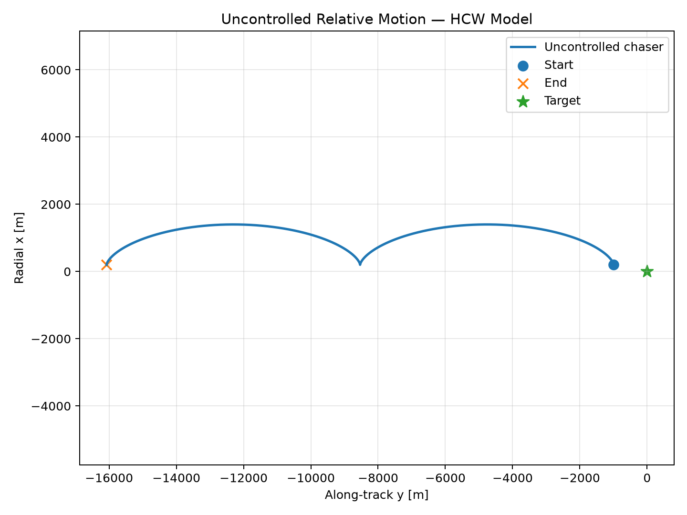
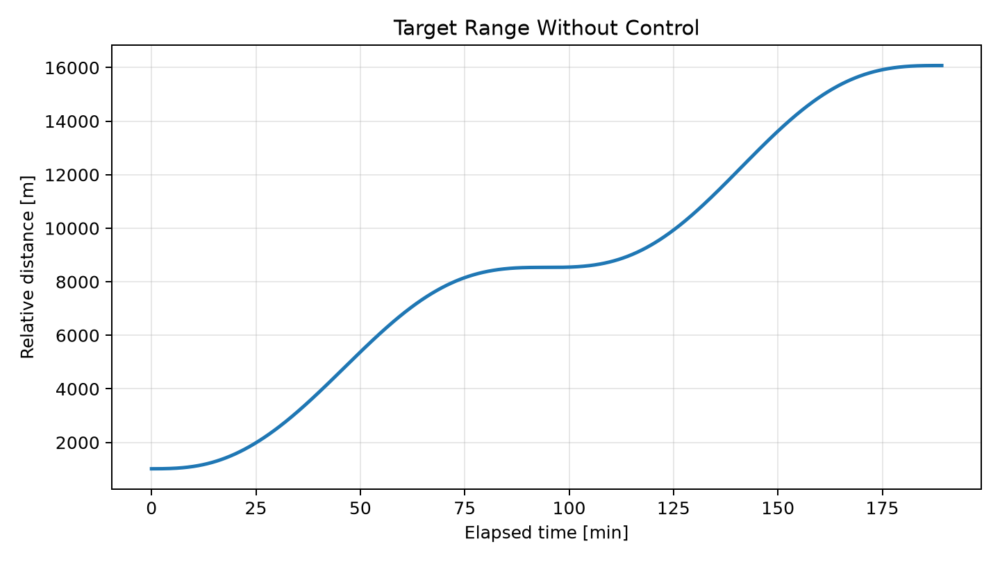
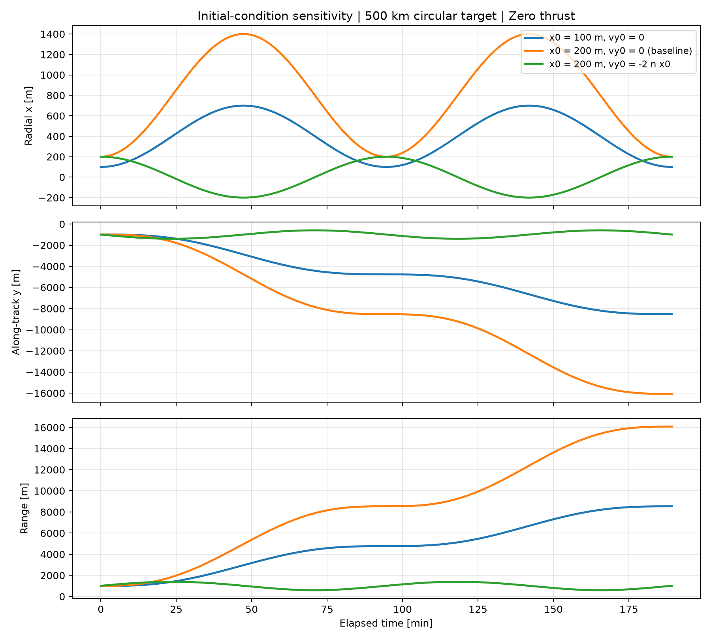

# Week 1 baseline review — October 13, 2026

## What was actually present

The chat's workspace `C:\Users\Surface\OneDrive\SatelliteRendezvous` was empty.
The existing project was found at:

```text
C:\Users\Surface\OneDrive\Documents\Satellite-Rendezvous\satellite-rendezvous-starter\satellite-rendezvous
```

Nineteen source/documentation/configuration/result files were copied into the
chat workspace. The original directory was left intact; its virtual environment,
caches, and bytecode were not copied. No AGENTS.md instructions were found in the
inspected project or its ancestor directories.

The inspected starter contained:

```text
rendezvous/       __init__.py, constants.py, hcw.py, visualization.py
scripts/          __init__.py, run_baseline.py
tests/            test_hcw.py (five tests)
docs/             model_assumptions.md, mission_requirements.md,
                  roadmap.md, learning_checklist.md, engineering_log.md
results/          baseline_relative_trajectory.png, baseline_range.png
.github/          workflows/python-tests.yml
README.md, requirements.txt, LICENSE (MIT), .gitignore
```

The baseline had already been changed to `[200, -995, 0, 0, 0, 0]`, rather
than the handoff's 100 m radial example. That experiment was preserved.
Neither the original project directory nor the current workspace contained a
local Git repository. The presence of a workflow file does not establish that
GitHub Actions has run; public GitHub publication remains unconfirmed.

## Environment and verification

The original Python 3.12 virtual environment existed but did not contain NumPy.
The default `python` command resolved to an inaccessible Windows application
alias. A new `.venv` was created here using the installed Python 3.12.6 executable,
and the four declared dependencies and their dependencies were installed.

This run used NumPy 2.5.4, SciPy 1.18.1, Matplotlib 3.11.2, and pytest 9.1.1.
`requirements-lock.txt` captures all resolved package versions for this tested
Python 3.12 Windows environment. The broader `requirements.txt` is retained.
`pip check` reported no broken requirements.

Commands executed from the current workspace:

```powershell
.\.venv\Scripts\python.exe -m pytest tests/test_hcw.py -q
# 5 passed: original Week 1 tests
.\.venv\Scripts\python.exe -m pytest -q
# 16 passed: original tests plus the state-space/physics checks
.\.venv\Scripts\python.exe -m scripts.run_baseline
.\.venv\Scripts\python.exe -m scripts.compare_initial_conditions
.\.venv\Scripts\python.exe -m pip check
```

The two baseline plots and the new comparison plot were regenerated and visually
inspected. All plots label axes and SI units. The baseline's planar trajectory
uses equal distance scales; its broad vertical limits reflect the much larger
along-track travel. It is an x-y projection, not a 3D plot. With z0 = vz0 = 0,
the baseline remains exactly in the orbital plane under HCW.

## Code review findings

`hcw_derivative` implements the documented equations with the correct signs and
state ordering. Acceleration is expressed in the target's rotating LVLH frame.
`analytical_uncontrolled` correctly includes both periodic and secular terms and
their velocity derivatives. `propagate_uncontrolled` uses SciPy RK45 with
rtol = 1e-11 and atol = 1e-12. Its initial state belongs to the first supplied
time; the analytical routine instead takes elapsed times. The baseline starts at
zero, so its existing comparison is consistent. A new test checks a nonzero start
time using `times - times[0]` for the analytical calculation.

`run_baseline.py` correctly uses orbital radius in computing mean motion,
propagates two target periods, and measures the norm of the numerical-minus-
analytical position difference. It now also reports velocity agreement and saves
inputs, solver settings, versions, and metrics as `results/baseline_summary.json`.
No physical-equation correction was needed.

The baseline does not check a mission success condition or provide controlled
approach, state estimation, thrust limits, or collision avoidance. It is an
uncontrolled dynamics experiment.

## Measured baseline results

| Quantity | Measured value |
|---|---:|
| Target orbital radius | 6,878,137 m |
| Mean motion n | 0.0011067834463 rad/s |
| One orbital period | 5,676.978 s = 94.616 min |
| Simulation duration | 11,353.956 s = 189.233 min |
| Samples, including endpoints | 1,201 |
| Initial range | 1,014.901 m |
| Final range | 16,075.889 m |
| Maximum sampled position difference | 4.477413e-8 m |
| Maximum sampled velocity difference | 5.302043e-11 m/s |

The last two rows measure numerical agreement with the same HCW physics. They
are neither sensor accuracy nor the error relative to a real orbit. At the end,
the chaser is roughly 16 km away; nonlinear two-body comparison is needed before
assessing linearization error over this growing displacement.





## Interpret the plots from the equations

For the current initial velocities of zero and z0 = 0, the closed-form solution
reduces to:

\[
x(t)=(4-3\cos nt)x_0,\qquad
y(t)=y_0+6x_0(\sin nt-nt),\qquad z(t)=0.
\]

The radial coordinate oscillates between x0 and 7x0: 200 m and 1,400 m.
The term `-6 n x0 t` in y is secular drift. After one period, sine vanishes
and nt = 2 pi, giving `y(T) = y0 - 12 pi x0`. After two periods,
`y(2T) = y0 - 24 pi x0 = -16,074.645 m`. These explain the two arcs in the
trajectory plot and the growing range. Negative y means behind the target.

The final relative velocity returns approximately to zero at an integer number
of periods for this initial condition. This is instantaneous rest, not a stable
hold: the nonzero radial coordinate still causes radial acceleration.

More generally, the secular term is `-(6 n x0 + 3 vy0)t`. It disappears when
`vy0 = -2 n x0`. At x0 = 200 m this is -0.442713 m/s.

| Zero-thrust case | Range after two periods |
|---|---:|
| x0 = 100 m, vy0 = 0 | 8,535.408 m |
| x0 = 200 m, vy0 = 0 | 16,075.889 m |
| x0 = 200 m, vy0 = -2 n x0 | 1,014.901 m |

All other initial components are identical. The third case is bounded periodic
relative motion and returns to its starting state; it does not approach or
stabilize at 20 m. Its range varies throughout the orbit.



Before running another case, predict how positive vx0 introduces oscillatory
along-track motion and how nonzero z0 or vz0 excites the independent cross-track
oscillator. Then compare your prediction with the closed-form solution.

## Completed next milestone and the next decision

`hcw_state_space(n)` exposes A and B while preserving the scalar ODE as an
independent implementation. The added checks cover all matrix columns, matrix
exponentials versus analytical propagation, controllability, radial waypoint
equilibrium, secular drift, periodic motion, time origins, and invalid matrix
mean motion. See the [step-by-step derivation](hcw_state_space.md).

Before controller development, choose the **direction** of the 20 m waypoint.
In this model a radial waypoint requires `ax = -3 n^2 xd`, or -7.349818e-5 m/s^2
at xd = 20 m; a purely along-track waypoint is an unforced equilibrium. Also
choose the terminal position tolerance and available acceleration. Those choices
determine what the controller must achieve and whether a hold is feasible.

The next implementation should be an explained, unsaturated LQR demonstration
with the correct equilibrium feedforward, followed by a separate saturation
experiment. Verify eigenvalues and equilibrium residuals before reporting
terminal errors, time, and delta-v.
